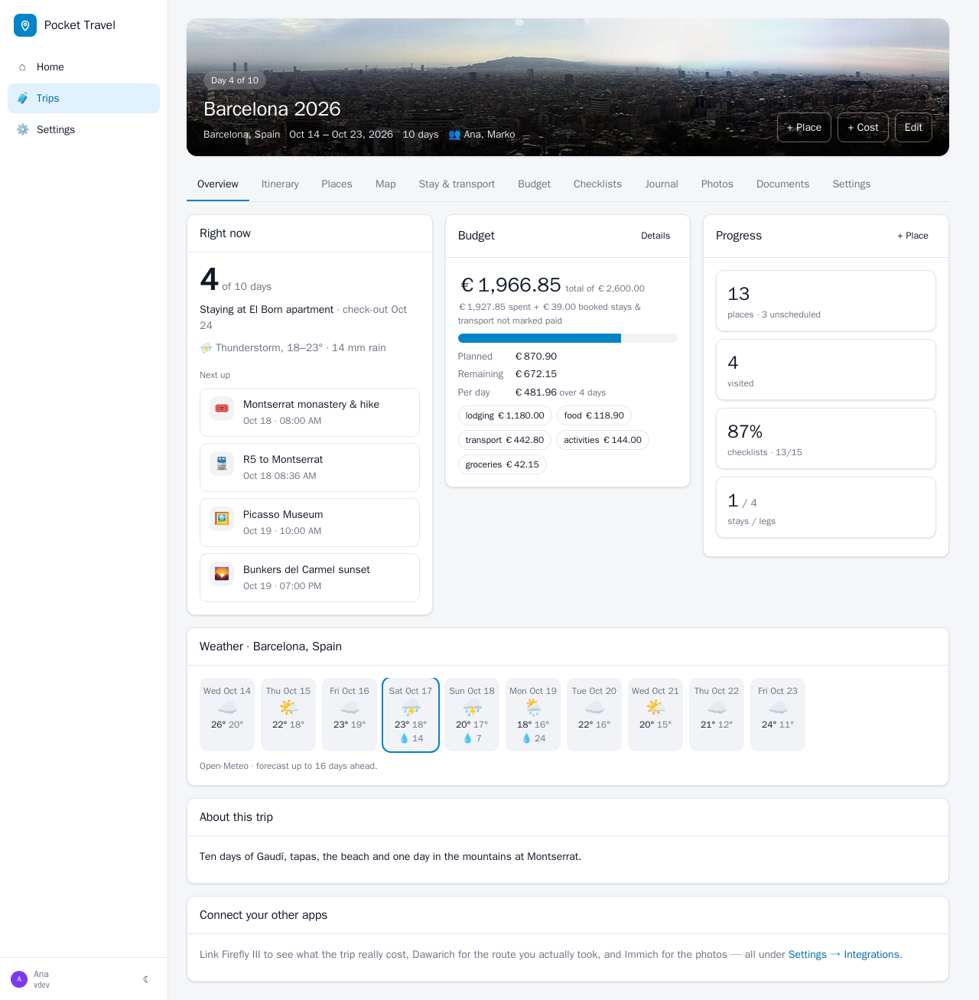
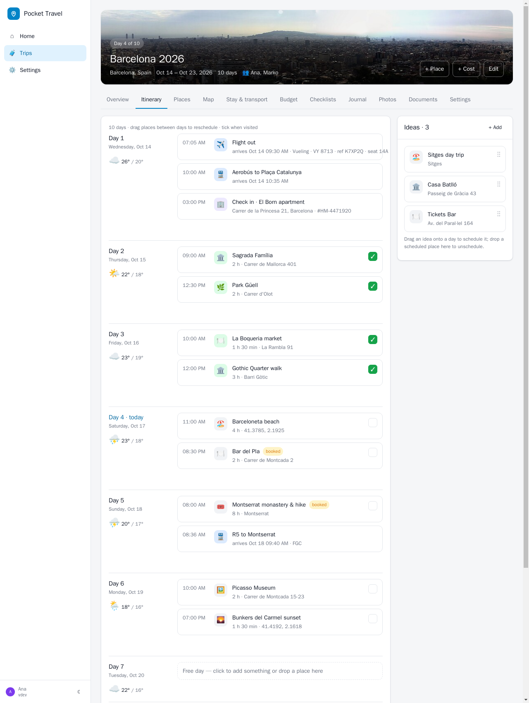
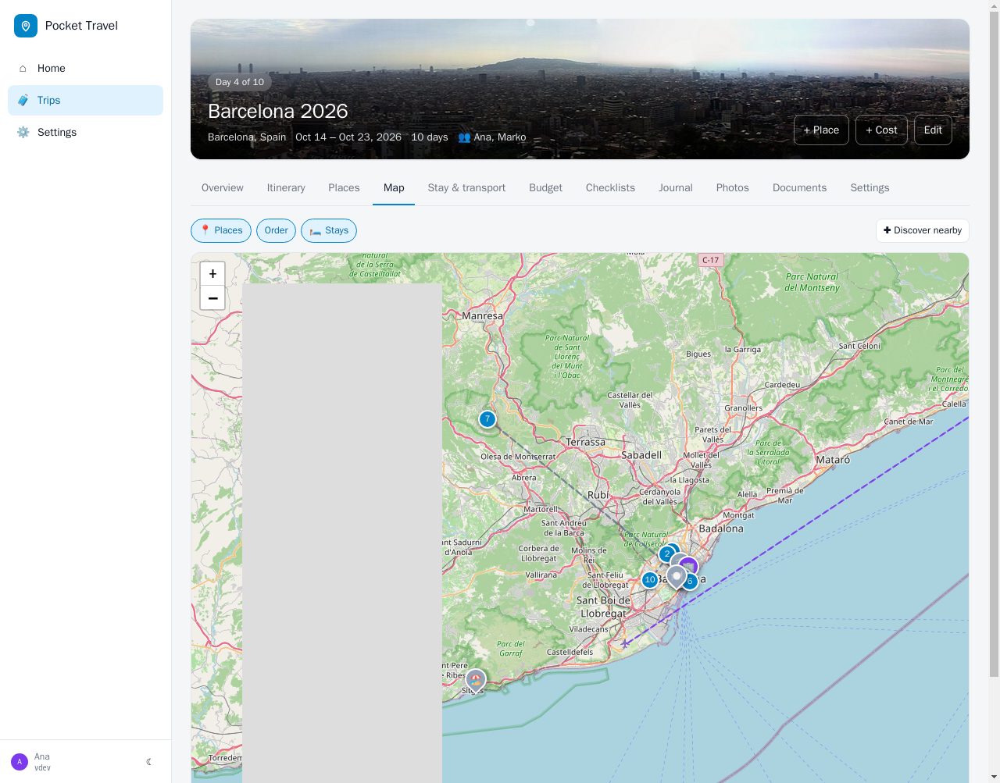
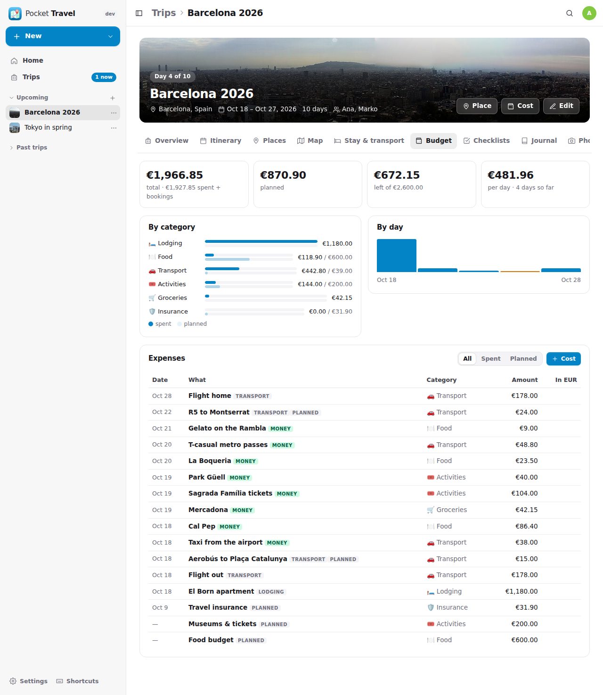
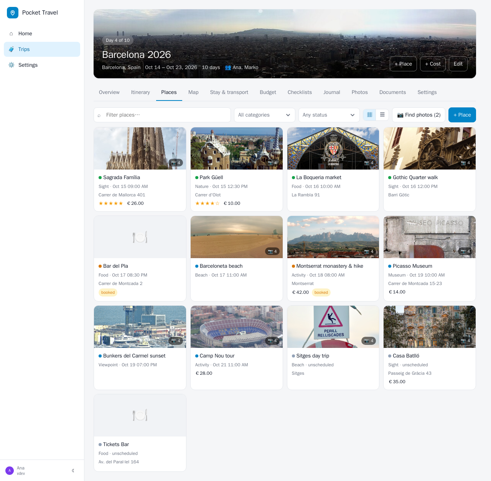
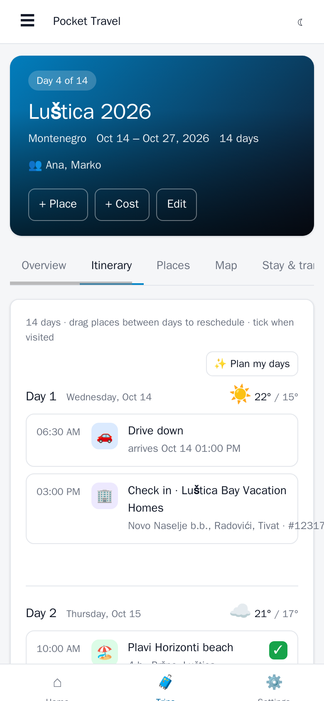
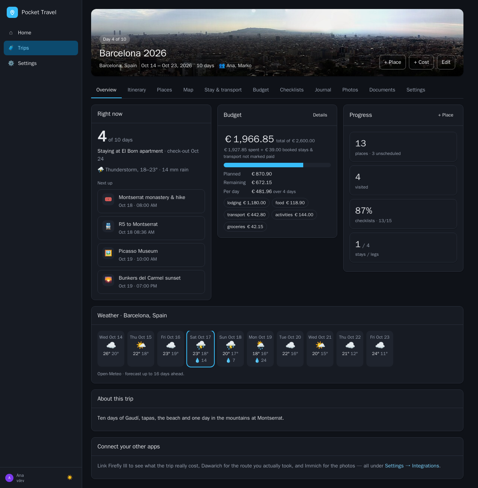
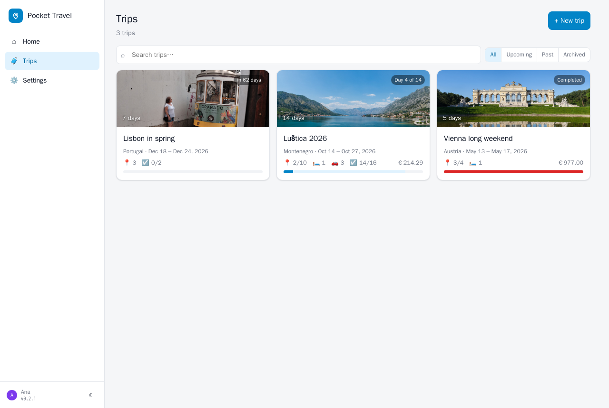

<p align="center">
  
</p>
<h1 align="center">Pocket Travel</h1>
<p align="center">
  A trip planner that keeps the whole trip on one page — the plan, what it really cost, where you actually went and what you photographed — as a small self-hosted server.<br>
  <b>One binary · one SQLite file · one volume.</b>
</p>
<p align="center">
  <a href="https://github.com/abjelosevic88/pocket-homelab-travel/actions"></a>
  <a href="https://github.com/abjelosevic88/pocket-homelab-travel/pkgs/container/pocket-homelab-travel"></a>
  <a href="LICENSE"></a>
</p>

---

Every trip I plan ends up spread over five apps: the list of places in one, the bookings in a mail folder, the budget in Firefly III, the route my phone recorded in Dawarich, the photos in Immich. This puts the plan next to the record, on one page per trip, on your own server. Built around four things:

- **An itinerary you drag.** One row per day with the weather, the places in order, check-ins and transport legs. Ideas sit in a side list until you drop them on a day; tick them off as you go. The day's recorded journeys and stops from Dawarich appear inline, so the plan and what happened sit next to each other.
- **Money that is real.** Stays and transport add their price as a planned cost. Tag your withdrawals in Firefly III with the trip's tag and they show up as spent — in their own currency, converted at the day's rate — with planned vs spent per category, per day, the burn rate and what is left. No key for the exchange rates (Frankfurter, open.er-api.com).
- **The map that knows both.** Numbered itinerary order, stays, the route Dawarich recorded, the stops it detected and the geotagged Immich photos, each a toggleable layer. *Discover nearby* lists OpenStreetMap points of interest around any spot; place search is Nominatim; descriptions come from Wikipedia. Nothing needs an API key.
- **Everything else a trip needs.** Checklists from templates (beach, city, hiking, winter, camping, car, kids, to-do before leaving), a journal with a mood per entry from everyone on the trip, documents (tickets, bookings, insurance), companions with roles, a calendar you can subscribe to, GPX and JSON exports, import from AdventureLog, duplicate last year's trip with shifted dates.

With an OpenAI key (or any compatible endpoint) five more buttons appear: **suggest popular places** for the destination (each located with OpenStreetMap before you add it), **plan my days** (ideas get a day and a time, nearby things together; you review before anything changes), **describe** a place with practical tips, a **packing list** written for the dates, weather and activities, and a **recap** of the trip in story, summary or caption form, written only from what the trip knows.

<p align="center"></p>

<table>
  <tr>
    <td width="50%"></td>
    <td width="50%"></td>
  </tr>
  <tr>
    <td align="center"><sub>Itinerary: drag ideas onto days, tick places when visited, Dawarich journeys inline.</sub></td>
    <td align="center"><sub>Map: itinerary order, stays, recorded route, detected stops, photo locations — each a layer.</sub></td>
  </tr>
  <tr>
    <td width="50%"></td>
    <td width="50%"></td>
  </tr>
  <tr>
    <td align="center"><sub>Budget: planned vs spent by category and by day; Firefly rows are marked and convert at the day's rate.</sub></td>
    <td align="center"><sub>Places: cards or a table, filter by category and status, ✨ Suggest when a key is set.</sub></td>
  </tr>
</table>

<p align="center">
  &nbsp;&nbsp;
  <br>
  <sub>Installable PWA with a bottom tab bar, plus dark mode.</sub>
</p>

<p align="center"></p>

## Features

| Area | What you get |
|---|---|
| **Trips** | Dates, destination (geocoded), home currency, budget, colour and a cover photo for the banner (trip Settings → Upload cover), status, notes. Owner / editor / viewer per companion. Archive, duplicate with shifted dates, delete. |
| **Itinerary** | Day rows with Open-Meteo weather (forecast 16 days ahead, archive for past days), drag and drop between days, start times and durations, visited ticks, check-in / check-out and transport legs inline, Dawarich journeys and stops per day. |
| **Places** | Category, address, coordinates (search, paste a Google/Apple Maps link, click the map), link, phone, price, rating, booking reference, tags, notes. A photo gallery per place: new places get up to four pictures from the Wikipedia article or photos taken at the spot on Wikimedia Commons (credit and licence kept), plus your own uploads; pick the cover. Status idea → planned → booked → visited / skipped. Nominatim search, Overpass *Discover nearby*, Wikipedia descriptions. |
| **Stays & transport** | Hotels, apartments, camping…; flights, trains, buses, cars, ferries… with carrier, number, seat, booking reference, from/to with coordinates, distance. Prices become planned costs automatically. |
| **Budget** | Planned vs spent in the trip currency, per category, per day, burn rate, remaining. Firefly III sync by tag (every 30 min for running and upcoming trips, on every save, on demand). Any currency, converted at the day's rate; the rate is cached. |
| **Recorded** | Dawarich: simplified route polyline, kilometres per day (from Dawarich's own timeline), detected stops, GPX export of the track. Immich: photos and videos by day, geotagged ones on the map, thumbnails proxied so the key stays on the server. |
| **Checklists, journal, documents** | Templates or a generated list, multi-line paste, assignees, progress. Journal entries with a mood from everyone on the trip. Documents stored next to the database, linked to a stay, leg or place. |
| **AI (optional)** | Suggest places, plan the days, describe a place, packing list, recap. OpenAI or any compatible endpoint (Ollama, LM Studio, OpenRouter). Nothing runs unless you press the button. |
| **Exports & imports** | iCalendar feed to subscribe to (stays, legs, scheduled places with references), GPX, JSON backup. Import from AdventureLog (collections with locations, lodging, transportation, notes, checklists and images) or a JSON backup. |
| **Users & ops** | Built-in login (admin/member), SSO-proxy header, or no login on a trusted LAN. API tokens. SQLite backup from the UI/CLI/API, Prometheus `/metrics`, `GET /dashboard` for Homepage. With **Pocket Core** on the box: registers itself, publishes `travel.trip_created`, `travel.trip_updated` and `travel.expense_linked`, accepts paired-phone tokens, finds Pocket Money's Firefly API without a `FIREFLY_URL`, and offers “Sign in with Pocket Core” with zero configuration (any OpenID Connect provider works via `OIDC_*`). |

## Run it

```bash
mkdir pocket-travel && cd pocket-travel
curl -fsSLO https://raw.githubusercontent.com/abjelosevic88/pocket-homelab-travel/main/docker-compose.yml
docker compose up -d
# open http://localhost:8080 and create your account
```

Or with plain Docker:

```bash
docker run -d --name pocket-travel -p 8080:8080 -v ./data:/data -e TZ=Europe/Berlin \
  ghcr.io/abjelosevic88/pocket-homelab-travel:latest
```

Want to look around first? Add `-e DEMO_DATA=true -e AUTH_MODE=none` to get three sample trips (one running, one past, one upcoming) with no login.

Binaries for Linux, macOS and Windows are attached to every [release](https://github.com/abjelosevic88/pocket-homelab-travel/releases), and a systemd unit is in [deploy/systemd](deploy/systemd).

Then connect your other apps under **Settings → Integrations**: a Firefly III personal access token, a Dawarich API key, an Immich API key, optionally an OpenAI key. Each has a *Test connection* button. Everything is per person: each account has its own trips and its own integrations, and sees someone else's trip only when the owner adds them to it (on a shared trip the route and photos come from the viewer's own Dawarich and Immich, the spending from the owner's Firefly).

## Configuration

Everything is an environment variable with a sensible default. The important ones:

| Variable | Default | Notes |
|---|---|---|
| `TZ` | `UTC` | Day boundaries for "today", the itinerary and Dawarich. Set it. |
| `BASE_URL` | – | Public URL, used in calendar exports. |
| `DATA_DIR` | `/data` | Database, uploaded files and backups live here. |
| `AUTH_MODE` | `local` | `local` (built-in login, multi-user), `proxy` (trust `Remote-User` from your SSO proxy), `none` (single implicit user, trusted LAN only). |
| `ADMIN_EMAIL` / `ADMIN_PASSWORD` | – | Create the first admin without the setup screen. |
| `SECURE_COOKIES` | `false` | Set `true` behind HTTPS. |
| `DEFAULT_CURRENCY` | `EUR` | Home currency until changed in Settings. |
| `FIREFLY_URL` / `FIREFLY_TOKEN` | – | Firefly III base URL + personal access token. |
| `DAWARICH_URL` / `DAWARICH_API_KEY` | – | Dawarich base URL + API key. |
| `IMMICH_URL` / `IMMICH_API_KEY` | – | Immich base URL + API key (`IMMICH_PUBLIC_URL` for browser links when the API URL is internal). |
| `OPENAI_API_KEY` / `OPENAI_MODEL` / `OPENAI_BASE_URL` | – / `gpt-4o-mini` / OpenAI | Enables the ✨ features; any OpenAI-compatible endpoint works. |
| `DEMO_DATA` | `false` | Seed sample trips into an empty database. |

Integration settings saved in the UI win over the environment. The full list is in [docs/configuration.md](docs/configuration.md), and reverse-proxy snippets are in [docs/reverse-proxy.md](docs/reverse-proxy.md).

## How it works

- **A trip is the unit.** Places, stays, legs, costs, lists, journal and documents hang off it; its dates, currency and timezone drive everything else. A place with a day is on the itinerary, a place without one is an idea.
- **Planned costs follow the items.** A stay or leg with a price owns one `source=item` expense that updates and disappears with it. Firefly rows are `source=firefly`, keyed by the transaction id, so a re-sync updates instead of duplicating; you may re-categorise them locally, everything else follows Firefly. Each expense stores its own currency, the rate of the day and the amount in the trip currency.
- **Dawarich is read as the trip's date range** in the trip's timezone: slim points are simplified with Douglas–Peucker for drawing, the per-day distances come from Dawarich's own timeline (which knows about tracks and gaps the raw points miss), and the result is cached — an hour while the trip runs, a week after.
- **Immich is searched by `takenAfter`/`takenBefore`** with timeline visibility (Live Photo companions stay hidden); thumbnails are fetched by the server with the key and streamed to the browser.
- **The outside world is cached** in one table: Open-Meteo per trip and location, Overpass per spot and category, exchange rates per pair and day.
- **AI only proposes.** Suggestions are geocoded with Nominatim before you can add them; the planner returns slots you edit and then apply; the recap uses only the trip's own facts.

## Automation

Create a token under **Settings → API tokens**, then:

```bash
# the whole trip in one call
curl -fsS https://travel.example.com/api/v1/trips/1/overview -H "Authorization: Bearer pt_…"

# add a place
curl -fsS -X POST https://travel.example.com/api/v1/trips/1/places -H "Authorization: Bearer pt_…" \
  -H "Content-Type: application/json" -d '{"name":"Sagrada Família","category":"sight","lat":41.4036,"lng":2.1744,"day_date":"2026-08-30","start_time":"09:00"}'

# log what you just spent
curl -fsS -X POST https://travel.example.com/api/v1/trips/1/expenses -H "Authorization: Bearer pt_…" \
  -H "Content-Type: application/json" -d '{"name":"Dinner","category":"food","amount":4820,"currency":"EUR","kind":"actual","date":"2026-08-30"}'

# pull Firefly now instead of waiting for the next sync
curl -fsS -X POST https://travel.example.com/api/v1/trips/1/firefly/sync -H "Authorization: Bearer pt_…"

# subscribe a phone's calendar to the trip
https://travel.example.com/cal/1.ics?token=pt_…

# compact status for a Homepage / Glance widget
curl -H "Authorization: Bearer pt_…" https://travel.example.com/api/v1/dashboard
# → {"trips":3,"upcoming":1,"days_traveled":41,"places":57,"next_trip_text":"Lisbon in spring in 62 days"}
```

Amounts are integers in minor units (`4820` = 48.20 EUR). Everything else, including the AI endpoints and the Homepage `customapi` widget, is in [docs/api.md](docs/api.md).

## Coming from AdventureLog

**Settings → Import → From AdventureLog**: enter the instance URL and your login, pick the collections, choose whether to download images. Locations become places (visited ones keep their date), lodging and transportation map one to one, notes become journal entries, checklists come with their items, and the old planned-costs note turns into planned expenses. Legs that AdventureLog itself imported from Dawarich are skipped — the route is live here. Running the import again adds only what is new.

## Backups

The database is a single file; uploaded documents and images are plain files next to it.

- **UI:** Settings → Backup & data → *Download database* (a consistent `VACUUM INTO` copy).
- **CLI:** `docker exec pocket-travel pocket-travel backup` writes to `/data/backups/`.
- **API:** `GET /api/v1/backup`.
- **Per trip:** JSON backup under the trip's Settings tab, re-importable.

Restic / Borg / Backrest users: back up `DATA_DIR`, but snapshot the live `pocket-travel.db` through one of the methods above rather than copying the WAL files raw. See [docs/backup.md](docs/backup.md).

## Development

```bash
make dev      # Go API on :8080 (demo data, no login) + Vite on :5173
make test     # go vet + go test + tsc
make all      # production build: web UI embedded into ./pocket-travel
```

Requires Go 1.22+ and Node 20+. Stack: Go + chi + modernc SQLite (no CGO), and React 19 + Vite + TypeScript with Leaflet for the maps and no UI framework. Planned next steps are in [docs/roadmap.md](docs/roadmap.md).

## Credits

The shape of a trip — collections of places, lodging, transportation, notes and checklists — follows [AdventureLog](https://github.com/seanmorley15/AdventureLog), which this replaces for me by putting the plan next to the record. Maps © [OpenStreetMap](https://www.openstreetmap.org/copyright) contributors; place search by Nominatim, points of interest by Overpass, weather by [Open-Meteo](https://open-meteo.com), exchange rates by Frankfurter and open.er-api.com. The cover photos in the screenshots are from Wikimedia Commons: [Barcelona 270º](https://commons.wikimedia.org/wiki/File:Barcelona_270%C2%BA.jpg) by Theklan (CC BY-SA 4.0), [Gloriette Schönbrunn Wien](https://commons.wikimedia.org/wiki/File:Gloriette_Sch%C3%B6nbrunn_Wien.jpg) by Der Wolf im Wald (CC BY-SA 3.0 de), [Skyscrapers of Shinjuku](https://commons.wikimedia.org/wiki/File:Skyscrapers_of_Shinjuku_2009_January.jpg) by Morio (CC BY-SA 3.0). Sibling projects built the same way are [Pocket Habits](https://github.com/abjelosevic88/pocket-homelab-habit-tracker), [Pocket Inventory](https://github.com/abjelosevic88/pocket-homelab-inventory), [Pocket Bookshelf](https://github.com/abjelosevic88/pocket-homelab-bookshelf), [Pocket Split](https://github.com/abjelosevic88/pocket-homelab-cost-split), [Pocket Clips](https://github.com/abjelosevic88/pocket-homelab-clips), [Pocket Subtitles](https://github.com/abjelosevic88/pocket-homelab-subtitles) and [Pocket Invoicing](https://github.com/abjelosevic88/pocket-homelab-invoicing).

## License

MIT
