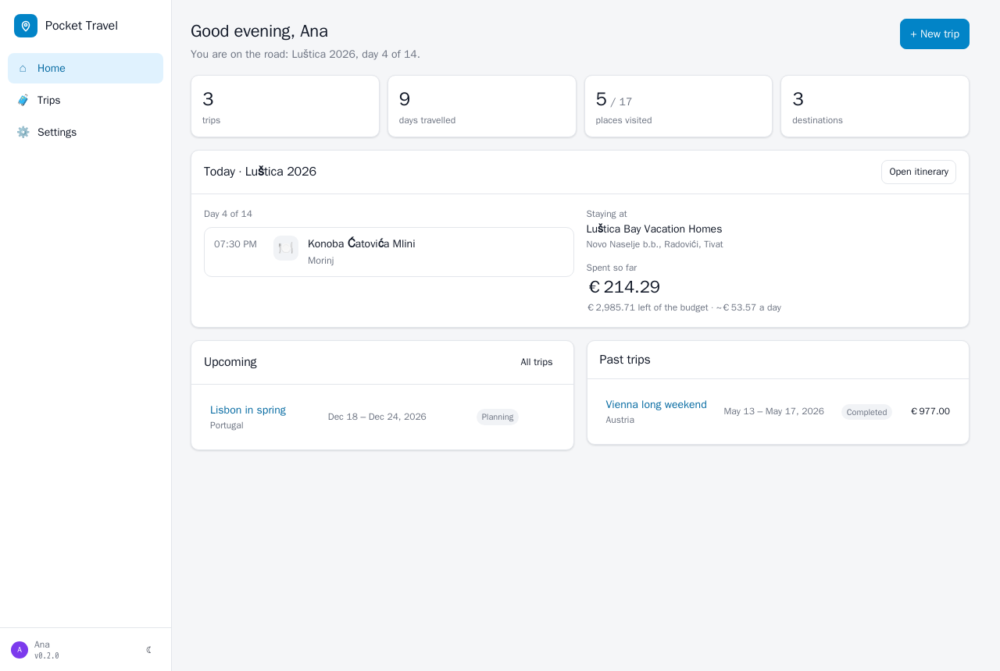
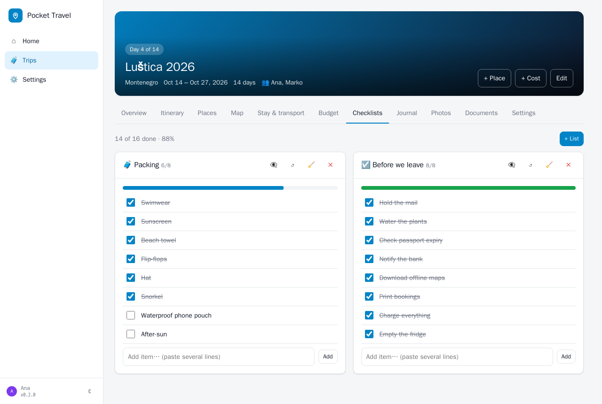

<p align="center"></p>
<h1 align="center">Pocket Travel</h1>
<p align="center">A self-hosted trip planner that keeps the whole trip on one page.</p>
<p align="center"><a href="https://github.com/abjelosevic88/pocket-homelab-travel/actions/workflows/ci.yml"></a> <a href="https://github.com/abjelosevic88/pocket-homelab-travel/releases"></a> </p>


A self-hosted trip planner that keeps the whole trip on one page: the itinerary, the places you want to see, where you sleep, how you get there, what it costs, what to pack and what happened — plus three things no other planner shows together:

- **Firefly III** — tag your withdrawals and the trip shows what it *really* cost, by day and category, in any currency.
- **Dawarich** — the route you actually travelled drawn over the plan, kilometres per day, the stops it detected.
- **Immich** — every photo taken between the trip dates, by day, the geotagged ones on the map.
- **OpenAI (optional)** — suggest popular places for the destination, plan the days, describe a place, write a packing list for the weather and activities, and turn the journal into a recap.

One Go binary, one SQLite file, one volume. React UI, works on a phone, dark mode. No API keys needed for maps (OpenStreetMap), place search and discovery (Nominatim, Overpass), weather (Open-Meteo) or descriptions (Wikipedia).

## Features

- **Trips** with dates, destination, budget in a home currency, cover photo, companions (owner / editor / viewer).
- **Itinerary**: one row per day with weather, places in order, check-ins and legs. Drag ideas onto days, tick places off as visited. Dawarich journeys and stops appear inline.
- **Places**: category, address, coordinates (search or click the map), opening link, price, rating, booking reference, notes, photo. *Discover nearby* lists OpenStreetMap points of interest around any spot; *Fill from Wikipedia* writes the description.
- **Stays & transport** with reservation numbers, seats, carriers, prices — prices become planned costs automatically.
- **Budget**: planned vs spent, per category, per day, burn rate, remaining. Spent money comes from Firefly III (every 30 min while the trip runs) or by hand; anything in another currency is converted at the day's rate.
- **Checklists** from templates (beach, city, hiking, winter, camping, car, kids, to-do before leaving).
- **Journal** entries per day with a mood, from everyone on the trip.
- **Documents**: tickets, bookings, insurance — stored next to the database.
- **Map** with numbered itinerary order, stays, the recorded route, detected stops and photo locations as toggleable layers.
- **Exports**: calendar (.ics, subscribable), GPX (places, optionally the recorded track), JSON backup. **Import** from AdventureLog (collections → trips with everything in them) or a JSON backup. Duplicate a trip with shifted dates.
- **AI, if you want it**: with an OpenAI key (or any compatible endpoint such as Ollama) five buttons appear — *Suggest places* (popular, well-rated places not yet in the plan, each located with OpenStreetMap before you add it), *Plan my days* (assigns ideas to days and times, nearby things together, meals at meal times; you review before anything changes), *Describe + tips* on a place, a *packing list* generated from the destination, dates, weather and activities, and a *recap* in story, summary or caption form written only from what the trip knows.
- Dashboard endpoint for Homepage widgets, Prometheus metrics, API tokens, local / proxy / no-login auth.

## Screenshots

| Home | Itinerary |
|---|---|
|  |  |

| Map with the recorded route | Budget: planned vs spent |
|---|---|
|  |  |

| Places | Checklists |
|---|---|
|  |  |


## Quick start

```bash
docker run -d --name pocket-travel -p 8080:8080 -v ./data:/data \
  -e ADMIN_EMAIL=you@example.com -e ADMIN_PASSWORD=change-me-please \
  ghcr.io/abjelosevic88/pocket-homelab-travel:latest
```

Open http://localhost:8080. Connect Firefly, Dawarich and Immich under *Settings → Integrations* (or via environment, see [docs/configuration.md](docs/configuration.md)). `docker-compose.yml` has the full example.

Try it without logging in, with demo trips: `DEMO_DATA=true AUTH_MODE=none`.

## Build from source

```bash
make          # web UI + Go binary (needs Node 22 and Go 1.26)
make run      # demo data, no login, http://localhost:8080
make dev      # API on :8080 + Vite dev server on :5173
make test
```

## Documentation

[Configuration](docs/configuration.md) · [API](docs/api.md) · [Backup](docs/backup.md) · [Reverse proxy](docs/reverse-proxy.md) · [Roadmap](docs/roadmap.md)

## Sibling projects

Pocket Habits, Pocket Inventory, Pocket Bookshelf, Pocket Split, Pocket Clips, Pocket Subtitles, Pocket Invoicing — the same stack, the same conventions.

MIT.
